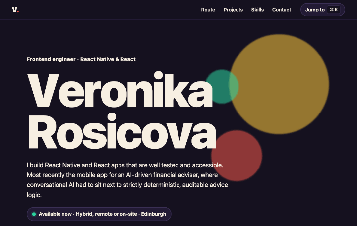

# Veronika Rosicova: CV site

[](https://github.com/rveruna/rveruna.github.io/actions/workflows/ci.yml)

**[Live site](https://rveruna.github.io/)**

[](https://rveruna.github.io/)

My CV as an interactive page: a career told as a bus route, live project demos you can open as case studies, a keyboard command palette, and a downloadable one-page CV.

React, TypeScript and Vite. No animation library, no UI kit.

## What's in it

- **Career as a bus route.** An SVG road winds past each job. The bus is placed on it from the scroll position (`getPointAtLength`, with a binary search to find the point at the current height). The road and cards are laid out from measured card heights, so nothing overlaps at any width.
- **Physics hero.** The letters of my name are spring-driven and flee the cursor. The spring is a pure function (`src/lib/spring.ts`).
- **Case studies with live demos.** All ten projects from my GitHub, as cards that morph into a dialog using the View Transitions API, with the deployed app embedded. A project with nothing to run in a browser (the Claude workflow kit) opens as text only. Browsers without View Transitions just open the dialog.
- **⌘K / Ctrl+K command palette.** An ARIA combobox: jump to a section, open a project or link, or download the CV.
- **CV download.** A one-page PDF, linked from the hero, the contact section and the palette. It is a static file in `public/`, linked through the site's base path so it works under any deploy path.

## Decisions worth a look

- **One data file.** Jobs, projects, links and skills live in `src/data/cv.ts`. The route, cards and palette all read it.
- **Pure logic, tested.** Route layout, nearest-stop and path-length search, command scoring and spring physics have unit tests, as do the project data and the case-study dialog. One test pins a bug I hit: fuzzy search matched "pdf" against hidden keywords.
- **Calm layout when it can't be wow.** Screens up to 980px wide get stacked cards, and touch screens get a static name. Anyone with `prefers-reduced-motion` gets no hero physics, no view transitions and no continuous bus movement: the bus just sits at the stop you're reading.
- **Accessible by construction.** Skip link, native `<dialog>` focus handling, focus returned to the card on close, a real heading structure, visible focus rings, 44px targets, and screen-reader text for the physics letters.

## Accessibility

`npm run a11y-audit` builds the site and runs [axe-core](https://github.com/dequelabs/axe-core) (WCAG 2.0 to 2.2, A and AA rules) in Chromium against the real page, in 11 states: light and dark, phone and desktop, reduced motion, the route scrolled, the case-study dialog open (desktop and phone, plus a project with no live demo) and the command palette open (light and dark). It runs in CI and fails the build on any violation. Currently 0.

**The audit is itself tested.** I broke the site on purpose, one rule at a time, to check the audit notices:

| Deliberate break | Caught? |
| --- | --- |
| Low-contrast text in light mode | Yes, axe `color-contrast` |
| Low-contrast text in dark mode | Yes, only in the dark scenarios, as it should be |
| Page with no `lang` | Yes, axe `html-has-lang` |
| Palette options outside a `listbox` | Yes, axe `aria-required-parent` |
| Embedded demo with no `title` | Yes, by an explicit check (see below) |
| Dialog with no accessible name | **No, at first.** axe's dialog-name rule only matches `role="dialog"`, not native `<dialog>`. I added an explicit check, and it now fails |

Two decisions came out of that:

- **The embedded demos are excluded from the scan.** axe scans inside iframes, which made results depend on whether another site had finished loading, and on that site's own bugs. Each demo is audited in its own repo; this site asserts what it owns, the frame's title.
- **A label-less input with a placeholder passes axe**, because browsers use the placeholder as a fallback name. The palette input has a real `aria-label` anyway.

**Checked by hand in a browser (Playwright):** keyboard use of the palette (arrows, Enter, Escape), Escape closing the case study with focus returning to the card, reduced motion turning off the hero physics, and no horizontal scroll from 360px to 1920px wide.

**Not tested:** a screen reader (VoiceOver, NVDA or TalkBack), 200% browser zoom, and Windows high-contrast mode. Automated tools catch only part of real accessibility problems, so 0 violations is a floor, not a guarantee.

For how I approach accessibility in components, see [accessible-rn-components](https://github.com/rveruna/accessible-rn-components): the same axe audit against Storybook, plus contrast tests and a mutation check.

## Run it

```bash
npm install
npm run dev      # http://localhost:5173
npm run build
npm test
npm run lint
npm run format
npm run a11y-audit   # builds, then runs axe in Chromium
```

## Not done

- No Lighthouse run in CI, so performance is checked by hand, not gated.
- The View Transitions animation is verified to open, close and return focus. I have not checked its look in Safari or Firefox.
- Embedded demos load from their own GitHub Pages sites, so the case-study dialog needs a network connection.
